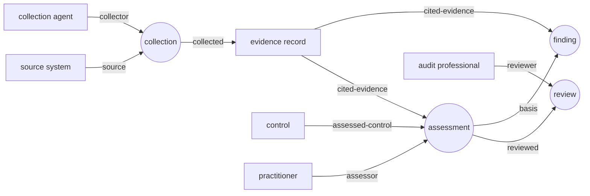

# Distributed ontology hypergraph: an audit engagement

A fictional professional-services firm assesses a fictional client's access and change-management controls. Four independent parties publish RFC 7951 JSON over HTTP. A collector merges their publications into one tree, and xYang checks that the engagement record is well formed: every conclusion cites existing evidence of an accepted kind, reviews are independent, and findings rest on exceptions.

All names, people, systems, and records are synthetic. *Larkspur & Reed* is not a real firm, *Alder Ridge Logistics* is not a real client, and nothing here describes any firm's methodology.

**A valid tree is not a clean audit opinion.** The sample engagement validates *and* reports a failed control: a terminated employee's account stayed enabled. Validation shows that the record of that conclusion is structurally sound and traceable, not that the client's controls work, that the evidence is true, or that professional judgment was applied well.

## The engagement

| Publisher | Document | Contents |
| --- | --- | --- |
| Firm methodology desk | [`documents/catalogue.json`](documents/catalogue.json) | Engagement scope, the controls under test, the people and agents on the team, and term definitions |
| Collection agent | [`documents/evidence.json`](documents/evidence.json) | Client source systems, evidence records with collection time and SHA-256 of each export, and collection records |
| Assessment agent and senior | [`documents/assessments.json`](documents/assessments.json) | One assessment per control, one finding, a workpaper bundle |
| Independent reviewers | [`documents/reviews.json`](documents/reviews.json) (seed) | Sign-off on each assessment |

The synthetic client exports are in [`documents/exports/`](documents/exports/).

| Control | Evidence cited | Assessor | Outcome | Review |
| --- | --- | --- | --- | --- |
| **AC-01** Leaver access is disabled within one business day | HR leavers, enabled accounts | drafting agent | **exception**: E1043 left 2026-08-14, account `jmarsh` still enabled and used 2026-08-26 | approved by R. Okafor |
| **CM-02** Privileged changes are approved by someone other than the implementer | change tickets, deployment log | M. Ito | **supported** | approved by R. Okafor |
| **AC-04** Quarterly user access review | none | drafting agent | **insufficient-evidence**: no review records provided | approved by M. Ito |

Finding `fd-ac-01` (high severity) is based on the AC-01 assessment and cites both exports.

Every record is a hypergraph element. Nodes are typed by identity (engagement, control, evidence record, source system, collection agent, assessment agent, audit professional). Hyperedges are typed relations whose participants carry roles:



## Run it

From the repository root, with Python 3.11 or newer:

```bash
pip install -e .
python -m http.server 8765 --bind 127.0.0.1 --directory examples/ontology-hypergraph   # terminal 1

python examples/ontology-hypergraph/collector.py \
  http://127.0.0.1:8765/documents/reviews.json -o /tmp/audit-projected.json   # terminal 2
python examples/ontology-hypergraph/audit_checks.py /tmp/audit-projected.json
```

The collector exits 0 and writes 4 documents, 22 nodes, and 11 hyperedges. `audit_checks.py` prints the conclusions, the finding, and an empty `issues` list.

The checked-in projections validate with either CLI:

```bash
M=examples/ontology-hypergraph/models
xyang validate --include-path $M $M/example-audit@2026-11-10.yang examples/ontology-hypergraph/fixtures/valid.json
xyang-ts validate --format json --include-path $M $M/example-audit@2026-11-10.yang \
  examples/ontology-hypergraph/fixtures/invalid/reviewer-is-assessor.json
```

Tests: `pytest tests/test_ontology_hypergraph.py -q` and `cd ts && npx vitest run test/ontology_audit_example.test.ts`.

## What xYang enforces

These checks are in [`models/example-audit@2026-11-10.yang`](models/example-audit@2026-11-10.yang) and behave the same in Python and TypeScript.

| Guarantee | Mechanism | Invalid fixture |
| --- | --- | --- |
| Cited evidence, sources, controls, reviewed assessments, and origins exist in the merged tree | `leafref` with `require-instance` | [`dangling-evidence`](fixtures/invalid/dangling-evidence.json) |
| A supported or exception outcome cites at least one evidence record; insufficient-evidence may cite none | `must` with `count()` on roles | [`assessment-without-evidence`](fixtures/invalid/assessment-without-evidence.json) |
| The reviewer is not the assessor of the reviewed assessment | `must` comparing role targets across hyperedges | [`reviewer-is-assessor`](fixtures/invalid/reviewer-is-assessor.json) |
| Exactly one reviewer and one reviewed assessment per review; one assessor, control, and engagement per assessment; one collector, source, and engagement per collection; no extra roles | `must` with `count()` and `derived-from-or-self()` | [`review-with-two-reviewers`](fixtures/invalid/review-with-two-reviewers.json) |
| A finding is based on an assessment whose outcome is `exception` | `must` across hyperedges | [`finding-on-supported-assessment`](fixtures/invalid/finding-on-supported-assessment.json) |
| Cited evidence has a type the control accepts | `must` comparing identityrefs | [`evidence-type-not-accepted`](fixtures/invalid/evidence-type-not-accepted.json) |
| Participants have the right kind: collectors are collection agents, reviewers are audit professionals, assessors are practitioners or professionals, evidence is an individual evidence record | `must` on each incidence with `derived-from-or-self()` | test cases |
| Outcome, decision, and severity values; timestamps and digests have the right shape; type-specific details appear only on that relation type | `enumeration`, `pattern`, `when`, `mandatory` | test cases |

An absent incidence list and an empty one both count as zero; the rules are written as counts, not presence.

## What stays outside YANG

| Concern | Where |
| --- | --- |
| Evidence collected after the assessment, or older than a configurable age | `audit_checks.py` (`--max-evidence-age-days`, default 30) |
| A review recorded before the assessment it reviews | `audit_checks.py` |
| A finding whose basis has no approved review | `audit_checks.py` |
| Cited evidence that no collection in the same engagement produced | `audit_checks.py` |
| Export bytes match the declared SHA-256 | collector (fetches each export) |
| Publications agree on model revisions and digests, versions, and element ownership | collector |
| Truth or completeness of client data, authenticity of publishers or reviewers, authorization, professional judgment, sampling, materiality, the audit opinion | not addressed |
| Consistency of publications fetched at different times | not addressed: there is no snapshot or transaction |

`audit_checks.py` exits 1 and lists each problem; it never silently passes a stale or unreviewed record. Its tests include trees that pass YANG but fail these checks.

A SHA-256 match proves the bytes are the bytes that were declared. It does not prove that the export is accurate or complete, or that the client produced it.

## Model layout

- [`example-hypergraph`](models/example-hypergraph@2026-11-10.yang) is the generic core: documents, nodes, hyperedges, role-labelled incidences, attributes, attachments, and provenance. It has no audit or BFO dependency. Incidence IDs keep repeated participants distinct; arity is unbounded and cycles are allowed.
- [`example-audit`](models/example-audit@2026-11-10.yang) instantiates the core in `example-audit:graph`. It adds identities for node kinds, relations, roles, and evidence types, a `refine` with the constraints above, and augments for engagement, control, evidence-record, result, sign-off, and finding details.
- [`example-bfo`](models/example-bfo@2026-11-10.yang) is optional context: a five-class alignment vocabulary with Basic Formal Ontology (BFO). Audit node kinds derive from those tags (engagement from process, people from material entity, others from continuant). This is a tag hierarchy, not OWL axioms.

## Collection contract

Each publication contains exactly one `document` record with its URL, version, the shared ontology-suite version, and the revision and SHA-256 of each model.

The collector:

1. fetches the seed, then follows `requires` entries and every referenced document, across origins, once each;
2. requires the same suite version and module set everywhere, checks each model's revision and digest against the bundled YANG, and fetches the published model source to compare bytes;
3. resolves element IDs, origins, evidence links, attachments, incidence targets, evidence-record `source-system`, and `export` against each publication's URL;
4. fetches each evidence export and compares its SHA-256 with the record;
5. rejects elements claimed by another publication, duplicate IDs, version mismatches, and unknown members;
6. validates the merged tree with xYang, rejecting warnings too.

A single publication is a partial tree whose cross-document references need not resolve on their own. Only the merged tree must satisfy the schema.

## Optional tools

`check_tools.py` runs `pyang --lint` and validates the projection independently with Yangson. `semantic_check.py` builds a partial RDF view and runs OWL RL over the BFO subclass and disjointness subset; adding `"also-type": ["example-bfo:occurrent"]` to an evidence record passes YANG but fails that check. Install these tools with `pip install -r examples/ontology-hypergraph/requirements-tools.txt`; their tests are skipped without them. Neither tool is needed for the core run. [`TRACEABILITY.md`](TRACEABILITY.md) maps mechanisms to RFC sections and lists what remains unassessed.

## Regenerate

YANG is the source. After editing it, run:

```bash
python examples/ontology-hypergraph/build_fixtures.py
```

This rewrites the publications, exports, the valid and invalid projections, and both schema inventories (`yang-library.json` for RFC 8525, `yangson-library.json` for Yangson's RFC 7895 input).

## Limits

HTTP(S) only. No redirects, authentication, signatures, content negotiation, or graph database. The demo collector trusts its publishers: it allows cross-origin fetches, caps each fetch at 2 MB and the graph at 32 documents, and times out after 10 seconds. Attributes are lexical strings, and `asserted-by` is an unverified IRI. Timestamps are checked for shape by YANG and compared only by `audit_checks.py`.
