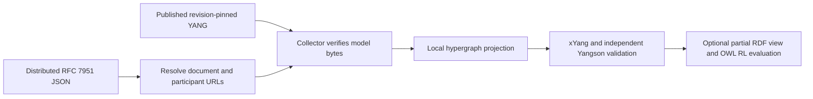

# Distributed ontology hypergraph

This runnable example represents a small BFO-aligned laboratory ontology fragment and its assertions using ordinary YANG 1.1 modules and RFC 7951 JSON. It demonstrates the transport and validation mechanisms needed to represent ontology content drawn from an ISO ontology. **It does not establish ISO conformity of the laboratory ontology, this representation, or xYang.** The [traceability matrix](TRACEABILITY.md) records demonstrated evidence and outstanding normative review.

ISO/IEC 21838-1 concerns requirements for top-level ontologies and their relationship to domain ontologies. ISO/IEC 21838-2 specifies BFO and includes requirements for BFO-based domain ontology modules. YANG describes the transported data structure; it supplies neither BFO's full axioms nor their model-theoretic semantics. The generic hypergraph is a representation mechanism, not a proposed top-level ontology. See the [ISO Part 1 scope](https://www.iso.org/standard/71954.html) and [Part 2 scope](https://www.iso.org/standard/74572.html).

## Run the complete workflow

Run from the repository root with Python 3.11 or newer. Using this checkout includes the identity-predicate fix from [PR #139](https://github.com/exergy-connect/xYang/pull/139).

```bash
python -m venv /tmp/xyang-ontology-env
source /tmp/xyang-ontology-env/bin/activate
pip install -e . pytest
# Optional independent YANG validators and semantic reasoner:
pip install -r examples/ontology-hypergraph/requirements-tools.txt
```

In terminal 1, publish the bundled models and independent JSON documents over HTTP:

```bash
python -m http.server 8765 --bind 127.0.0.1 --directory examples/ontology-hypergraph
```

In terminal 2, using the same environment:

```bash
python examples/ontology-hypergraph/collector.py \
  http://127.0.0.1:8765/documents/relations.json \
  -o /tmp/ontology-projected.json

# Independent syntax, RFC 8407 lint, and effective-tree validation:
python examples/ontology-hypergraph/check_tools.py /tmp/ontology-projected.json

# Optional OWL RL evaluation of a documented BFO class/disjointness subset:
python examples/ontology-hypergraph/semantic_check.py /tmp/ontology-projected.json \
  --rdf /tmp/ontology-semantic-view.ttl

pytest tests/test_ontology_hypergraph.py -q
```

The collector exits 0 and writes a tree containing three document records, five nodes, and two hyperedges. The independent check reports success. The optional semantic check reports an empty `errors` array. It does not invoke an external hosted service. Omitting optional tools skips only their two tests; the HTTP collector and xYang tests still run.

These are actual HTTP publications while the server is running, not a claim of permanent public hosting. For example:

| Resource | URL |
| --- | --- |
| Generic YANG source | `http://127.0.0.1:8765/models/example-hypergraph@2026-11-10.yang` |
| Effective domain model | `http://127.0.0.1:8765/models/example-lab@2026-11-10.yang` |
| BFO alignment vocabulary | `http://127.0.0.1:8765/models/example-bfo@2026-11-10.yang` |
| Independent evidence extension | `http://127.0.0.1:8765/models/example-lab-evidence@2026-11-10.yang` |
| Ontology term publication | `http://127.0.0.1:8765/documents/terms.json` |
| Individual publication | `http://127.0.0.1:8765/documents/entities.json` |
| Relation publication / entry point | `http://127.0.0.1:8765/documents/relations.json` |
| Addressable repeated participant | `http://127.0.0.1:8765/documents/entities.json#sample` |
| Addressable nested hyperedge | `http://127.0.0.1:8765/documents/relations.json#reaction` |
| RFC 8525 schema inventory | `http://127.0.0.1:8765/yang-library.json` |

An element URL dereferences to its containing JSON publication; the fragment selects the entry whose normalized `id` matches the full URL. This fragment-selection convention is defined by this example, not RFC 7951, a JSON Pointer standard, or a RESTCONF endpoint. Deploy the directory behind any HTTP(S) origin to publish it elsewhere. Relative document and model references resolve against each document's retrieval URL. Moving a publication changes its identities; preservation across moves would require an explicit identity/alias policy.



## Model boundaries and extensibility

[example-hypergraph](models/example-hypergraph@2026-11-10.yang) defines only generic identities and reusable groupings: documents, nodes, hyperedges, incidences, string attributes, external attachments, and provenance. Nodes and hyperedges have globally unique document-URL-plus-fragment IDs. The `hypergraph` grouping uses relative leafrefs so its references bind when instantiated by a host module.

[example-bfo](models/example-bfo@2026-11-10.yang) imports the generic vocabulary. It supplies a small identity hierarchy aligned with BFO entity, continuant, occurrent, material entity, and process, plus groupings for term definitions and additional classification tags. This is a small alignment vocabulary, not the BFO-2020 ontology. Its identities are YANG tags; identity derivation is not an OWL subclass axiom by itself.

[example-lab](models/example-lab@2026-11-10.yang) imports both modules and instantiates `hg:hypergraph` in `lab:graph`. Domain identities specialize material entity and process. Standard `uses`/`refine` adds reaction constraints; standard `augment` attaches term documentation and experimental metadata. Grouping instances belong to the using module's namespace, so their JSON names are local beneath `example-lab:graph`.

[example-lab-evidence](models/example-lab-evidence@2026-11-10.yang) is a separate provider's cross-module augment. Its `reviewed` leaf belongs to the provider module and therefore **must** be encoded as `example-lab-evidence:reviewed`. The collector loads this extension first and validates the imported laboratory tree after xYang has applied the augmentation. No schema nodes are rewritten by the collector. A new extension requires an explicit schema/inventory update; remote documents cannot install executable or arbitrary schemas.

The specimen and assay entries in `terms.json` denote domain universals and carry textual definitions and BFO alignment IRIs. `entities.json` contains synthetic individuals classified with those domain tags. A reaction hyperedge is an n-ary observation record; it is not asserted to be a BFO process or a new normative BFO relation. Role identities describe the transport profile. Full ontology definitions and relations need separately reviewed formal axioms.

An incidence is keyed by its occurrence ID, not by its target. In the fixture, `i1` and `i2` both target the same sample as inputs, while `o1` targets the product and `c1` the assay. No tuple deduplication loses those occurrences. Generic hyperedges allow zero or arbitrarily many incidences; the laboratory reaction profile requires at least one input and exactly one output, allows only input/output/context roles, and requires material-entity individual nodes for inputs and outputs. A bundle targets the reaction hyperedge through another incidence. Nesting is reference-based; cycles are permitted by the generic model.

## Resolution and validation contract

Every publication uses the same effective module set and contains exactly one `document` record with its URL, publication `version`, ontology suite version, and model name/revision/location/SHA-256 entries. Dependencies additionally pin the required document version.

The collector:

1. Fetches the seed and follows explicit dependencies and participant document URLs, including other HTTP(S) origins. It visits each document once, so dependency cycles terminate.
2. Requires a common ontology suite version and exactly the bundled effective module set. It checks model revisions and digests against trusted local YANG and fetches each published source to verify its bytes. This pins what is validated; it does not trust a document's digest alone.
3. Resolves the designated URI-reference fields: document IDs, dependencies, model locations, element IDs, origin, evidence, attachments, and incidence targets. Text labels, definitions, attribution IRIs, identityref values, and attribute strings remain unchanged. The source publications remain available separately; the merged projection does not preserve their original relative URI spellings.
4. Rejects elements claimed by a different publication, conflicting origins, duplicate element IDs across nodes and hyperedges, incompatible versions, and unresolved retrievals. A publisher owns every `document-url#fragment` identity under its document URL.
5. Merges complete records without dropping unknown members. Unknown schema fields then fail validation. A missing target fragment in an existing publication fails the local `leafref`; a missing document fails retrieval.
6. Runs xYang against the effective tree with default `require-instance true` leafrefs for participant targets, element origins, and document dependencies. It rejects validation warnings too. A narrow boundary check enforces JSON booleans for `reviewed`, because xYang currently also accepts lexical boolean strings.

A distributed shard is an RFC 7951-encoded **partial tree**. Its cross-document leafrefs need not resolve in isolation. It is the collected, projected tree that must satisfy the effective YANG schema. Collection policy and YANG schema validation are separate checks; neither establishes ontology semantics or provenance authenticity.

## Independent tooling and optional semantic evaluation

`check_tools.py` runs pyang `--lint` over all four YANG modules and asks Yangson to load them independently and validate the projection, including its XPath constraints. It does not consume an xYang-generated schema. `yang-library.json` is a module-set/schema inventory validated against the RFC 8525 YANG module in the repository with a content-derived `content-id`. It describes this static schema, with no datastore entries because this example provides no NMDA/NETCONF server. `yangson-library.json` is the generated deprecated RFC 7895 compatibility input required by Yangson 1.7. This is not a full implementation of RFC 8525 discovery or update notifications.

`semantic_check.py` uses the external RDFLib/OWL RL tools to build an explicitly partial RDF view. Published term URLs remain class identifiers; individual URLs remain individual identifiers; source and attribution are retained with PROV predicates. The view adds four BFO subclass relationships, continuant/occurrent disjointness, and the two local domain subclass relationships. Its BFO class identifiers and relationships are reviewable against the [BFO-2020 OWL artifacts](https://github.com/BFO-ontology/BFO-2020/tree/bd1fb61c5fa4e358fc9690f0d214b1ac63fae594/21838-2/owl). That reference is an implementation snapshot, not proof of equivalence to every normative axiom of ISO/IEC 21838-2.

This check demonstrates a real distinction: adding `"also-type": ["example-bfo:occurrent"]` to the material sample still passes YANG but produces an OWL RL disjointness error. The automated semantic test checks both outcomes. The RDF view deliberately excludes hyperedges, their roles, attributes, and temporal semantics. It is an evaluation view, not a reversible conversion of the canonical YANG/JSON data and not a replacement serialization. Unsupported or duplicate domain term mappings fail explicitly.

## Regeneration, tests, and limits

YANG files are the schema source. Regenerate the synthetic documents and both inventories after editing source YANG:

```bash
python examples/ontology-hypergraph/build_fixtures.py
pytest tests/test_ontology_hypergraph.py -q
```

Tests cover real HTTP publication and CLI collection, independent schema parsing and validation, namespaced RFC 7951 members and identityrefs, arrays and booleans, arbitrary arity, repeated participants, nesting and cycles, roles/types/cardinality, provenance, missing documents and fragments, identity conflicts, model digests/revisions, document and suite versions, and reproducible fixtures. The shared XPath predicate regression that this example exposed was delivered separately in PR #139.

Limits: HTTP(S) only; no redirects, alias equivalence, content negotiation, authentication, signatures, transactionally consistent remote snapshot, attachment fetching, graph database, or RESTCONF server. The demo client is intended for trusted publications: it permits cross-origin fetching, limits each fetch to 2 MB, caps graph documents at 32, and applies a 10-second request timeout. Immutable URLs and disciplined version publication are assumed. Model byte pins and document versions detect specific inconsistencies but do not authenticate publishers or pin instance bytes. Attributes are lexical strings. Provenance records claims, not independently verified facts. The reasoner handles only the stated subset; full BFO Common Logic axioms, temporalized participation, definitions, ontology-module obligations, and ISO conformity require specialized tools and normative review beyond this example.
